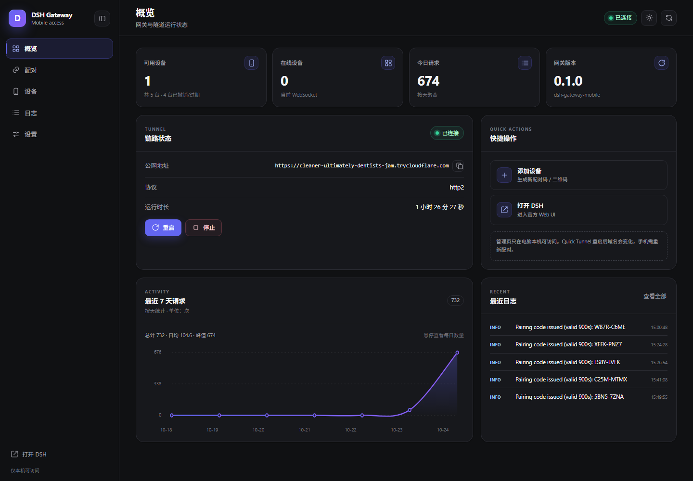
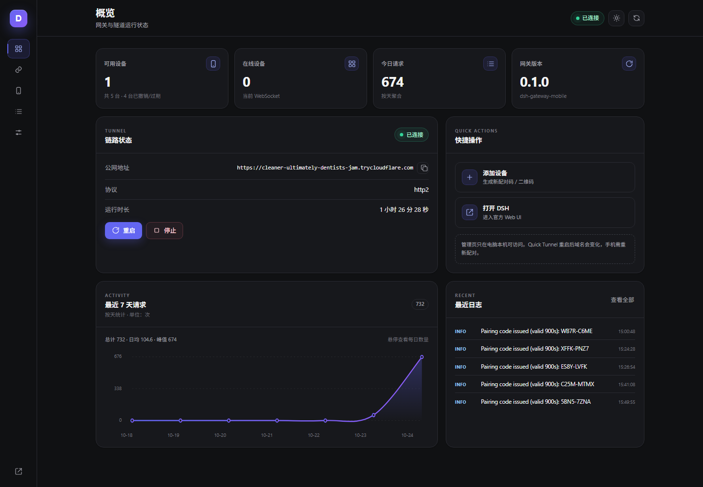
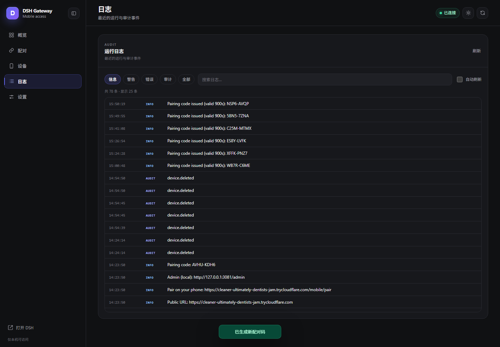
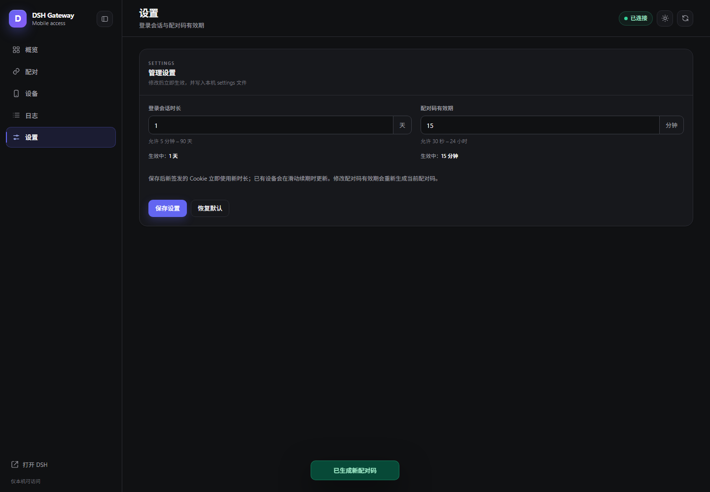
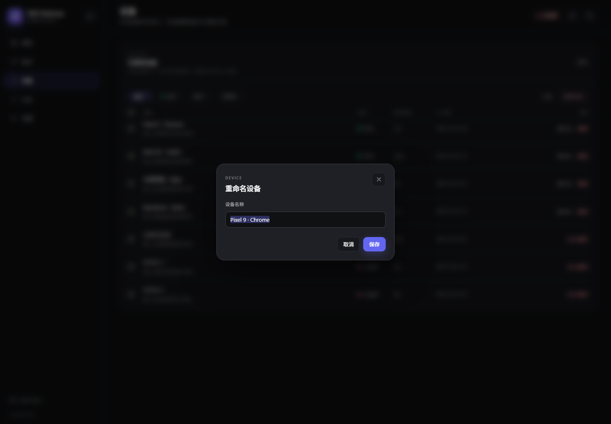
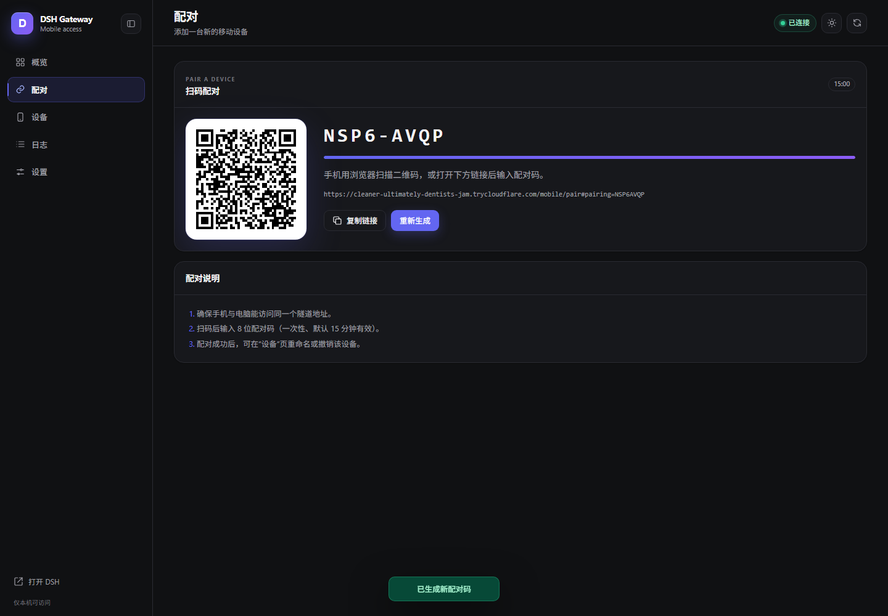
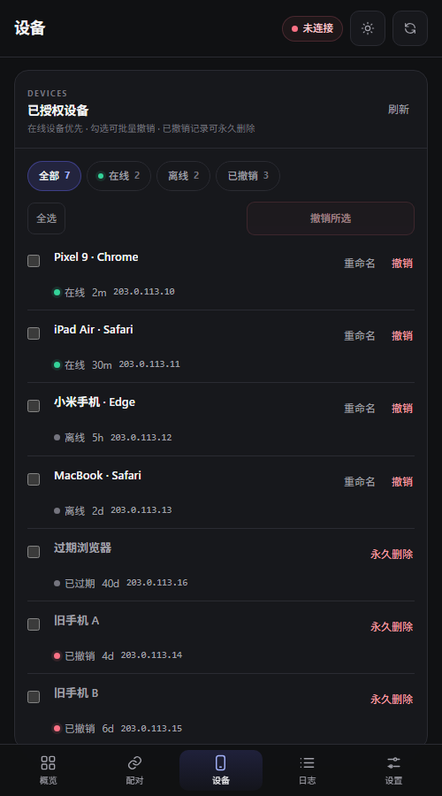
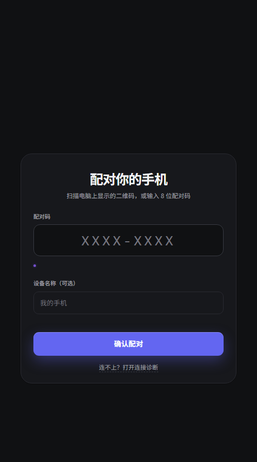
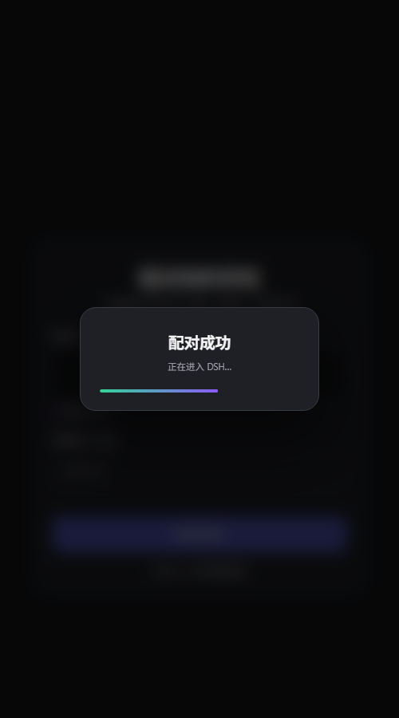

# Admin console

`http://127.0.0.1:3081/mobile/admin` — short bookmark alias
`http://127.0.0.1:3081/admin`; also available via `npm run admin`. Loopback only. The
page and admin APIs work without a device session on first run so the pairing QR can be
shown before any phone is paired. The admin console is a zh-CN operator surface; the
phone PWA pages follow the browser language (zh/en).

- **Overview**: tunnel state, public URL, protocol, seconds-precision uptime, 7-day
  request chart with hover/tap counts, recent logs, and KPI cards. 可用设备 counts
  authorized devices that are neither revoked nor expired; the footnote also shows the
  total registered count and how many records are revoked/expired.
- **Pairing**: QR, 8-character code, expiry progress, copy link, regenerate.
- **Devices**: online-first list with 全部 / 在线 / 离线 / 已撤销 filters and counts;
  per-device rename; single and batch revoke; permanent cleanup of revoked/expired
  records (per-row button, multi-select batch, or 清理已撤销 shortcut). Rows are dense:
  on desktop they use the table columns, on narrow screens status, last-active and IP
  collapse into one inline line so more devices fit on screen.
- **Logs**: structured rows (time, level badge, message) with level filters
  (信息 includes audit events; 警告 / 错误 / 审计 / 全部), keyword search and an
  auto-refresh toggle. DEBUG output is hidden by default; 全部 reveals it.
- **Settings**: session lifetime (days) and pairing-code TTL (minutes) with the allowed
  range shown under each field, inline validation, a “已保存 · time” confirmation, and a
  confirmed reset-to-default action. Values persist to `admin-settings.json`.

Desktop uses a collapsible sidebar (state persisted in `localStorage`); mobile uses bottom
navigation. The sun/moon toggle switches dark/light theme; the choice is stored under
`dsh-theme` and shared by the phone pages on the same origin.

Phone pages (`/mobile/`, `/mobile/pair`, `/mobile/devices`, `/mobile/oauth`,
`/mobile/diag`, `/mobile/shell`) share the admin console's tokens, icon set and dark-first
theme, and have their own theme toggle. Destructive actions on the phone use the same
styled dialogs; device rows show localized metadata, relative activity time and per-device
IP/bindings.

## Screenshots

Overview:

Collapsed icon rail:

Logs:

Settings:

Device rename dialog:

Pairing:

Mobile devices page:

Phone pairing page and success overlay:

