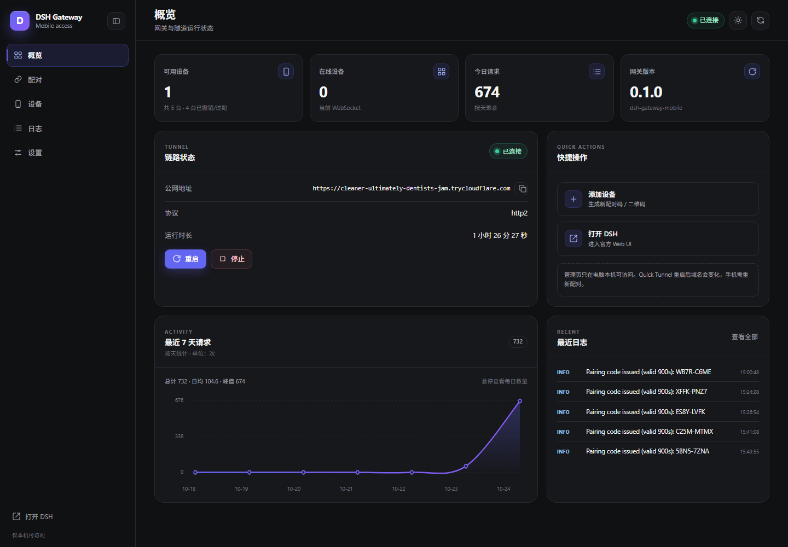
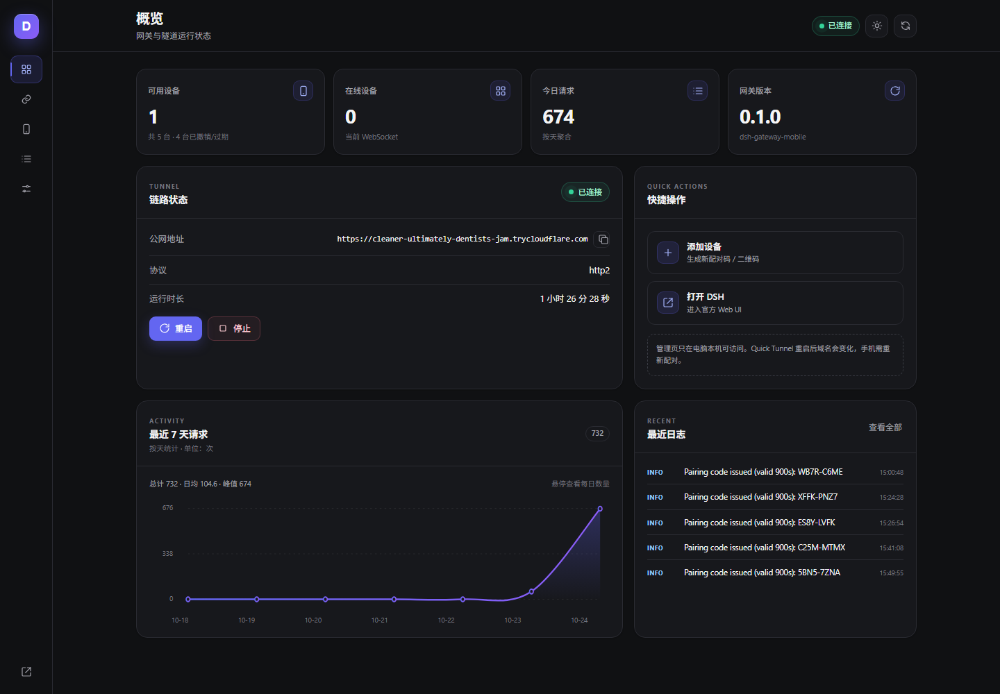
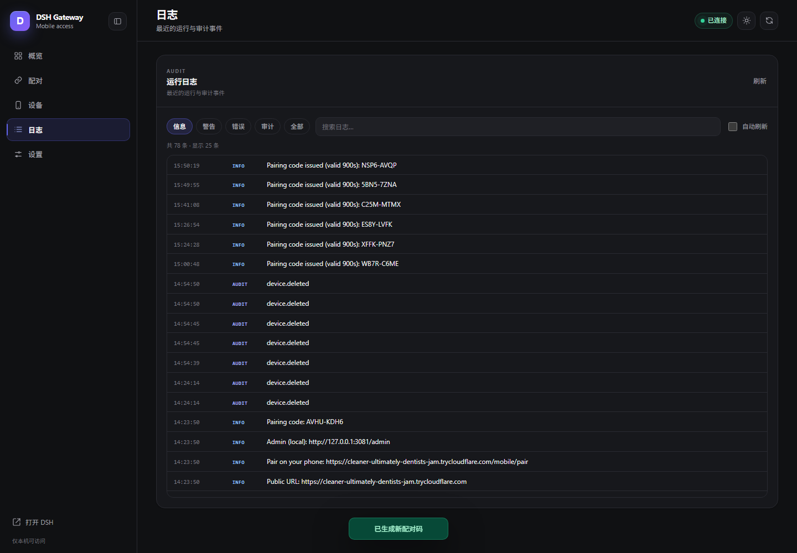
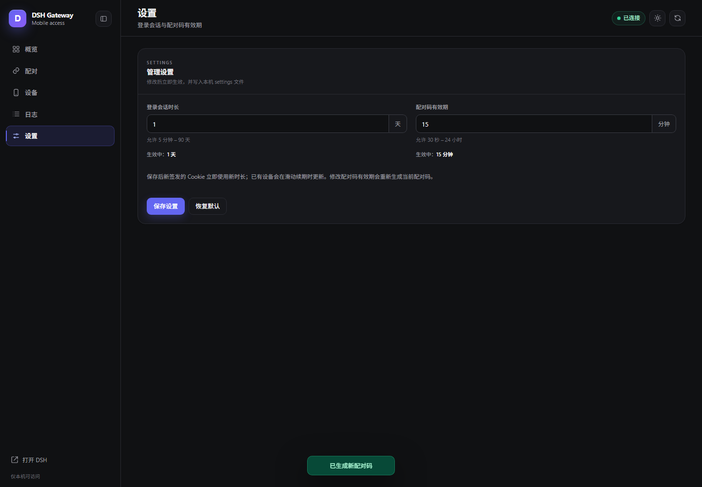
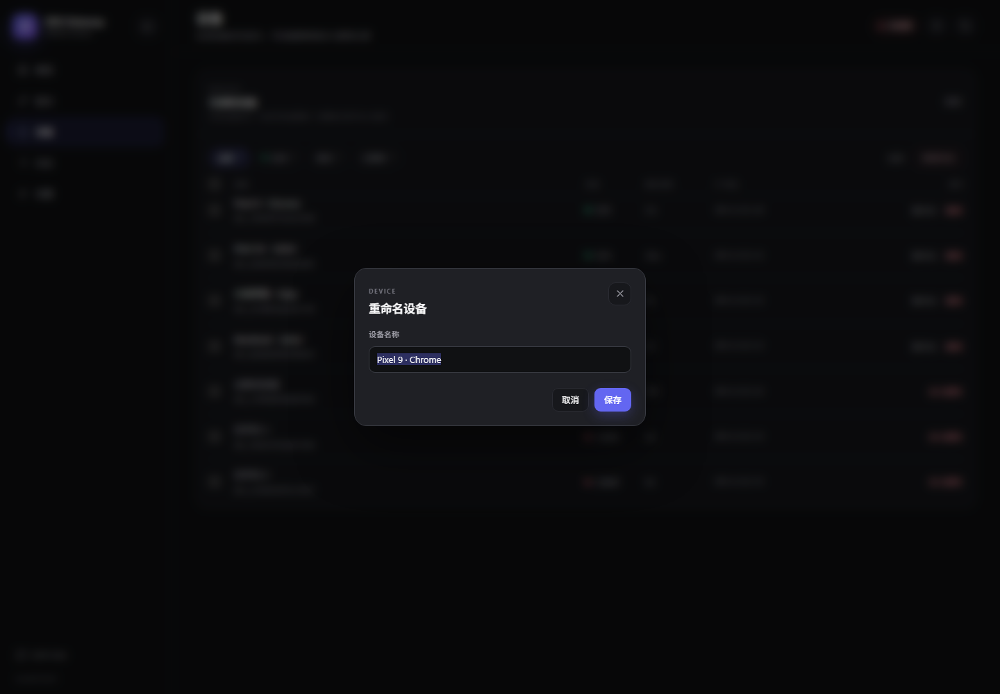
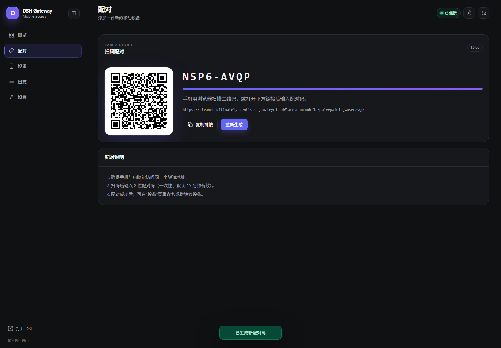
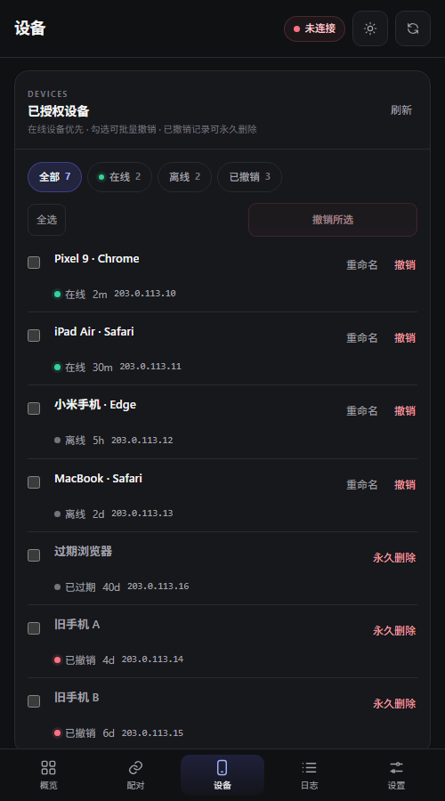
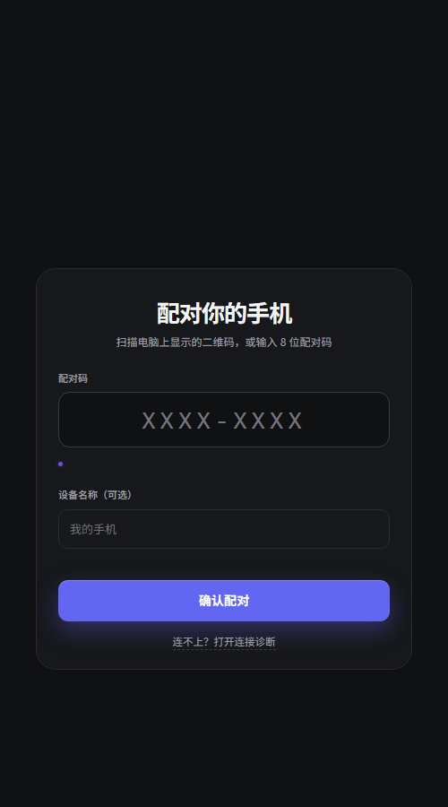
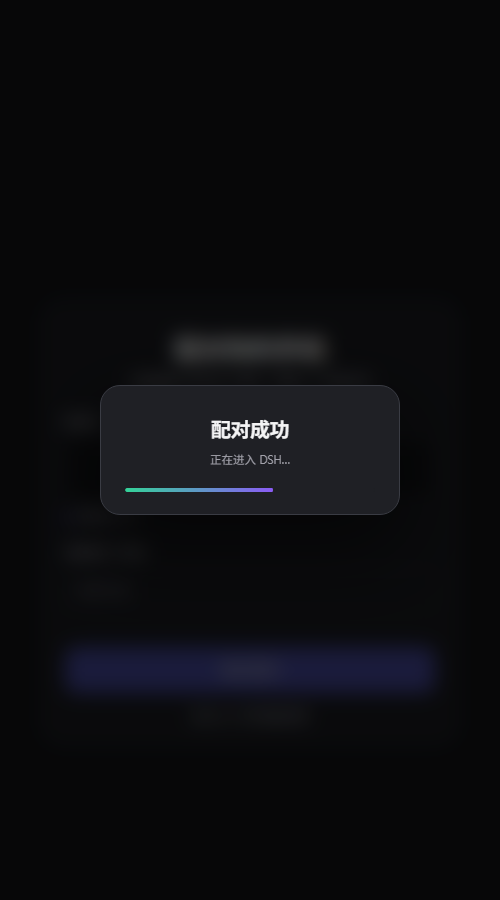

# Admin console

[English](./admin-console.md) | [中文](./admin-console.zh.md)

`http://127.0.0.1:3081/mobile/admin` — short bookmark alias
`http://127.0.0.1:3081/admin`; also available via `npm run admin`. Loopback only. The
page and admin APIs work without a device session on first run so the pairing QR can be
shown before any phone is paired. The admin console is a zh-CN operator surface; the
phone PWA pages follow the browser language (zh/en).

- **Overview**: a compact status strip with four chips (gateway, public tunnel, DSH upstream,
  WeChat bot) whose state comes from `/admin/health?deep=1`; a failing check surfaces as one
  alert row with a **查看诊断** shortcut, and missing DSH capabilities as a single warning
  line (hidden when every capability is present). Below it come the KPI cards
  (available/online devices, today's requests), then a two-column row with the **公网隧道**
  panel (public URL with copy, connector health, uptime, start/stop/restart) and the quick
  actions (add device, manage WeChat), and finally the request-traffic chart (7/14/30-day
  switch, persisted locally) — there is no collapsible "activity" header. Both the chips and
  the chart refresh from `/admin/health?deep=1` plus `/status` (which already carries
  `stats.summary(7)`). Logs are only rendered in the **Logs** tab, so the overview does not
  duplicate them. The plugin version lives in the **Help** tab, not on the overview.
- **Pairing**: QR, 8-character code, expiry progress, copy link, regenerate. An expired
  code is refreshed automatically once while the page is visible, and a persistent banner
  appears when the tunnel hostname changed (`previousUrl`/`urlChangedAt`) so the phone can
  be paired again.
- **WeChat**: three sub-sections — 连接 (QR login, re-bind, logout, runtime state, masked
  owner, poll timestamps, failure count), 推送 (notification policy, last failure and
  permanent-failure count, recent pushes) and 审批 (approval history). Pushing the policy
  here replaced the old Settings panel.
- **Devices**: online-first list with 全部 / 在线 / 离线 / 已撤销 filters and counts;
  per-device rename; single and batch revoke; permanent cleanup of revoked/expired
  records (per-row button, multi-select batch, or 清理已撤销 shortcut). Rows are dense:
  on desktop they use the table columns, on narrow screens status, last-active and IP
  collapse into one inline line so more devices fit on screen.
- **Logs**: structured rows (time, level badge, message) with level filters
  (信息 includes audit events; 警告 / 错误 / 审计 / 全部), keyword search and an
  auto-refresh toggle. DEBUG output is hidden by default; 全部 reveals it. An audit export
  toolbar filters by action prefix and time window (1h/24h/7d/all) and downloads
  `GET /admin/audit?...` as JSON.
- **Settings**: session lifetime (days) and pairing-code TTL (minutes) with the allowed
  range shown under each field, inline validation, a “已保存 · time” confirmation, and a
  confirmed reset-to-default action. Values persist to `admin-settings.json`. A
  “安全与密钥” panel shows the active key id and retained keys and rotates the secret key
  after typing `ROTATE` (existing sessions keep working; devices may need re-pairing only
  if keys are exhausted). A “运行开关” panel toggles the tunnel and the WeChat channel,
  selects the log level, and sets the DSH proxy timeout; changes apply immediately, are
  persisted for the next start, and the panel states that clearly.
- **Help**: FAQ for pairing failures, tunnel down, WeChat without a context, expired
  pairing codes and key rotation, a collapsed **诊断** section with the full
  `/health?deep=1` check list and the five-row capability matrix (refresh included), and
  the version/capability summary. An abnormal overview chip jumps straight to this
  section.

Desktop uses a collapsible sidebar (state persisted in `localStorage`); mobile uses bottom
navigation across the seven tabs. The sun/moon toggle switches dark/light theme; the choice
is stored under `dsh-theme` and shared by the phone pages on the same origin.

Phone pages (`/mobile/`, `/mobile/pair`, `/mobile/devices`, `/mobile/oauth`,
`/mobile/diag`, `/mobile/shell`) share the admin console's tokens, icon set and dark-first
theme, and have their own theme toggle. Destructive actions on the phone use the same
styled dialogs; device rows show localized metadata, relative activity time and per-device
IP/bindings.

## Screenshots

> The screenshots below predate the simplified overview (status chips + collapsed activity
> + diagnostics under Help); the rest of the console is unchanged.

Overview:

Collapsed icon rail:

Logs:

Settings:

Device rename dialog:

Pairing:

Mobile devices page:

Phone pairing page and success overlay:

