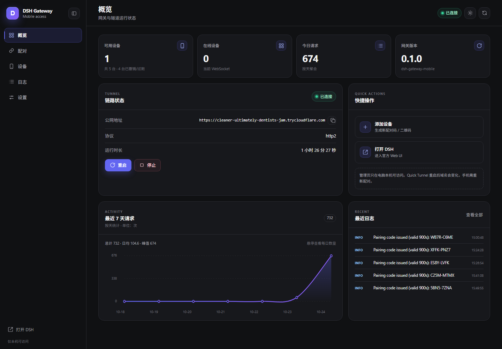
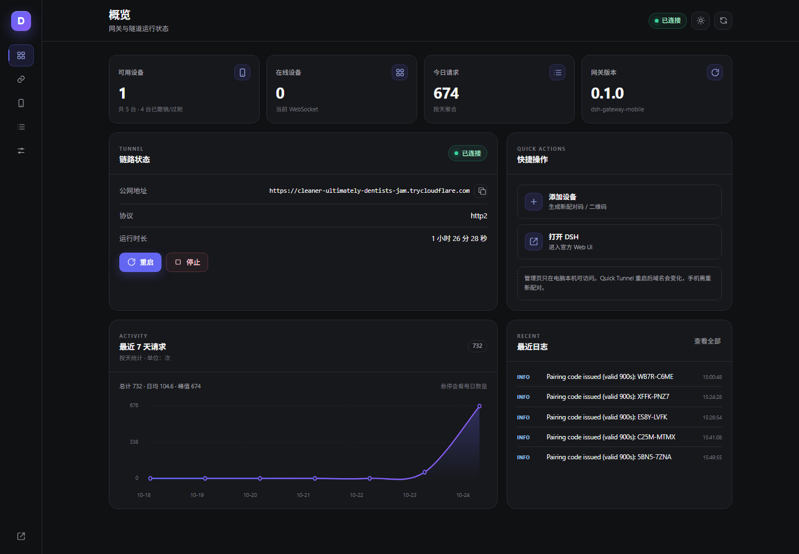
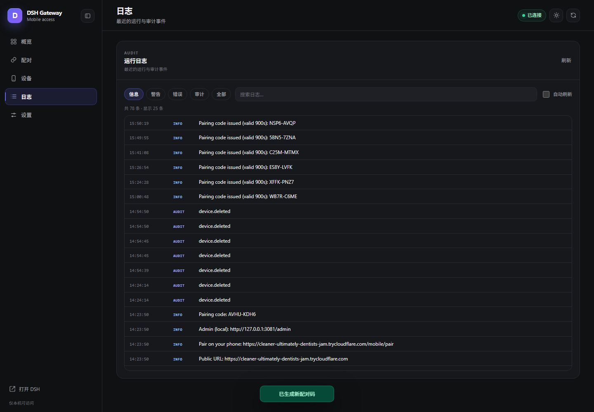
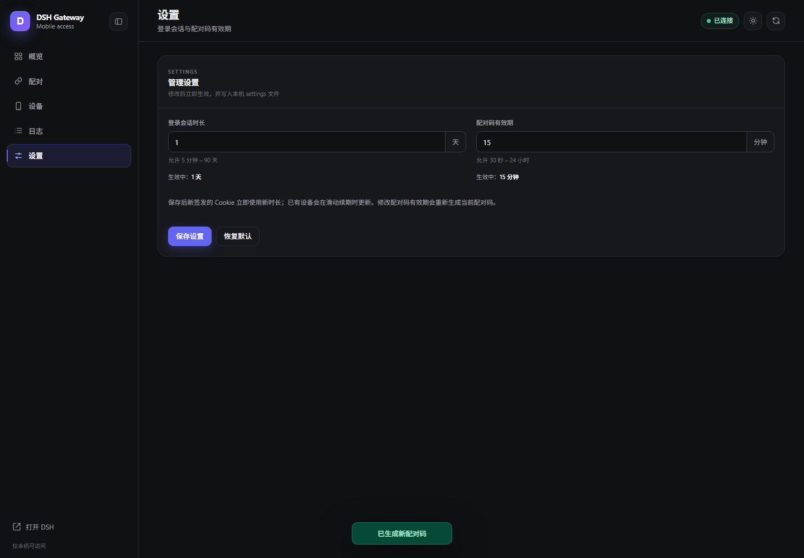
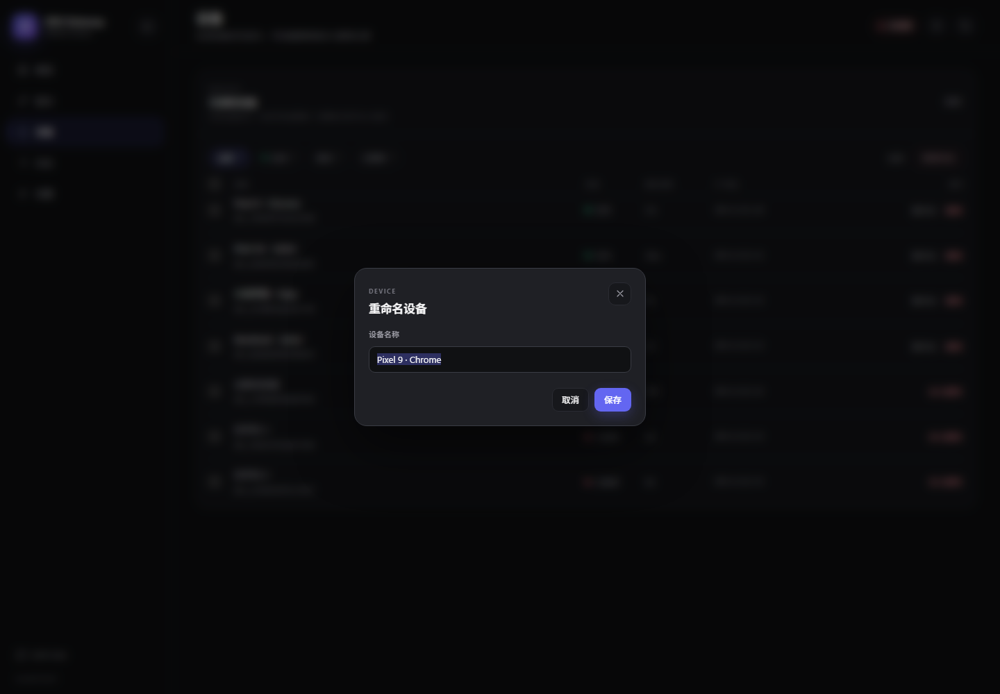
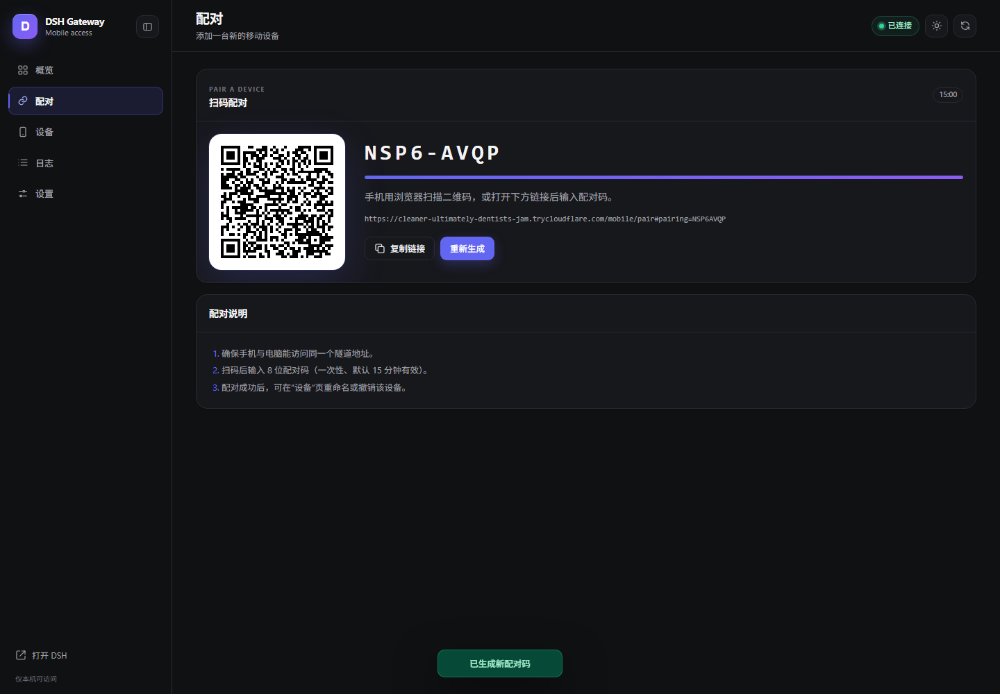
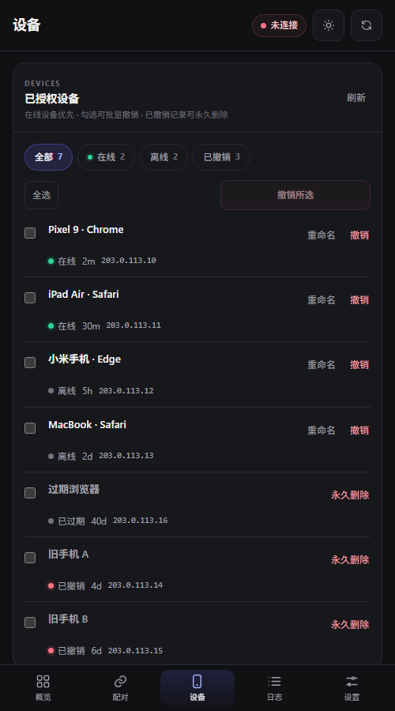
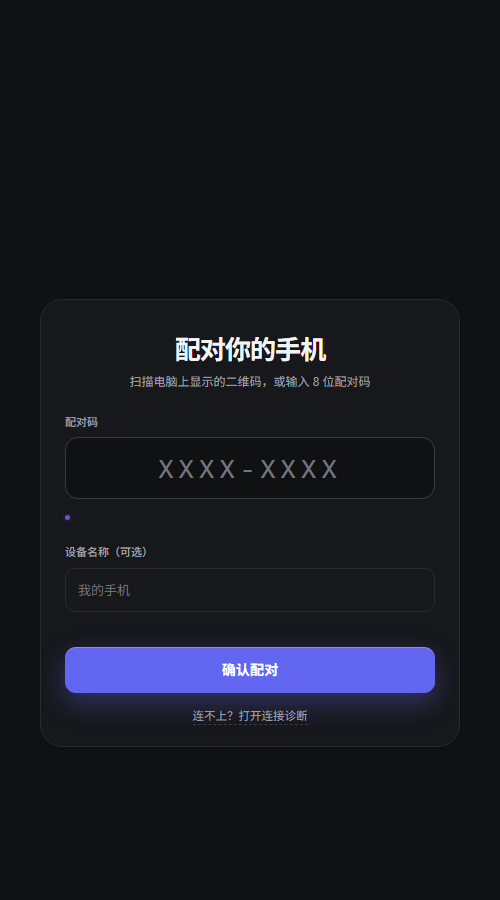
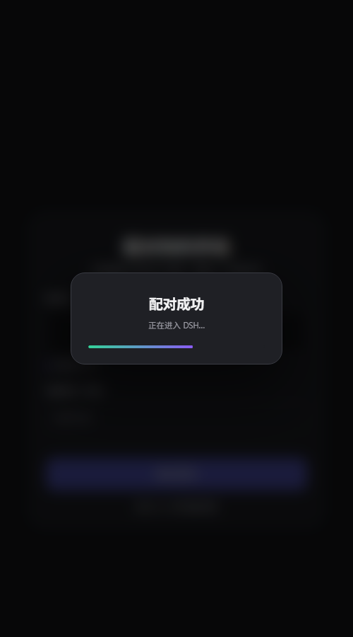

# 管理后台

[English](./admin-console.md) | 中文

`http://127.0.0.1:3091/mobile/admin` — 简写书签别名
`http://127.0.0.1:3091/admin`；也可通过 `npm run admin` 打开。仅限本机回环访问。
首次运行时尚无设备会话也可使用本页与 admin API，因此在任何手机配对之前就能展示
配对二维码。admin console 是 zh-CN 运维界面；手机 PWA 页面跟随浏览器语言（中文/英文）。

- **概览**：一行紧凑状态 chips（网关 / 公网隧道 / DSH 上游 / 微信 Bot），状态来自
  `/admin/health?deep=1`；检查失败时折成一条异常提示条，并提供「查看诊断」快捷入口；
  DSH 可选能力缺失时显示一行黄色提示（能力齐全时隐藏）。其下依次是 KPI 3 卡
  （可用/在线设备、今日请求）、一行两列的「公网隧道」（公网地址与复制、连接器健康、
  运行时长、启动/停止/重启）与「快捷操作」（添加设备、管理微信），最后是请求趋势图
  （可切换 7/14/30 天，选择本地持久化）——没有可折叠的「活动与统计」头部。chips 与
  图表分别由 `/admin/health?deep=1` 和 `/status`（已带 `stats.summary(7)`）刷新；日志只在
  「日志」tab 渲染，概览不重复展示。插件版本只在「帮助」tab 展示，概览不显示。
- **配对**：二维码、8 位配对码、有效期进度、复制链接、重新生成。页面可见时，
  过期配对码会自动刷新一次；当隧道主机名变化（`previousUrl`/`urlChangedAt`）时
  会出现常驻横幅，提醒手机重新配对。
- **微信**：三个二级分区 —— 连接（二维码登录、换绑、断开、运行状态、脱敏
  所有者、轮询时间戳、失败次数）、推送（通知策略、最近失败与永久失败次数、
  最近推送）和 审批（审批历史）。推送策略移到此处，取代了旧的设置面板。
- **设备**：在线优先列表，带 全部 / 在线 / 离线 / 已撤销 筛选与计数；单设备
  重命名；单个与批量撤销；永久清理已撤销/过期记录（行内按钮、多选批量，或
  「清理已撤销」快捷操作）。行布局紧凑：桌面端使用表格列，窄屏下状态、最近活跃
  和 IP 折叠为一行内联展示，以便一屏容纳更多设备。
- **日志**：结构化行（时间、级别徽标、消息），带级别筛选（信息 含审计事件；
  警告 / 错误 / 审计 / 全部）、关键字搜索和自动刷新开关。默认隐藏 DEBUG 输出；
  全部 会显示它。审计导出工具条可按 action 前缀与时间窗口（1 小时/24 小时/7 天/
  全部）过滤，并把 `GET /admin/audit?...` 下载为 JSON。
- **设置**：登录会话时长（天）与配对码有效期（分钟），每个字段下方展示允许范围，
  带内联校验、“已保存 · 时间”确认，以及需二次确认的恢复默认操作。取值持久化到
  `admin-settings.json`。「安全与密钥」面板展示活动密钥 id 与保留的密钥，输入
  `ROTATE` 后轮换密钥（已有会话继续有效；只有在密钥耗尽时设备才可能需要重新
  配对）。「运行开关」面板可切换隧道与微信通道、选择日志级别、设置 DSH 代理
  超时；修改立即生效并持久化供下次启动使用，面板中对此有明确说明。
- **帮助**：常见故障 FAQ（配对失败、隧道未连接、微信无 context、配对码过期、
  密钥轮换影响），以及默认收起的「诊断」区：完整 `/health?deep=1` 检查列表、
  五行能力矩阵（带刷新）和版本/能力摘要。概览上异常状态 chip 的点击会直接
  跳到该诊断区。

桌面端使用可折叠侧栏（状态持久化在 `localStorage`）；移动端通过底部导航在七个
tab 间切换。太阳/月亮按钮切换深/浅主题；选择存储在 `dsh-theme` 下，并与同源的
手机页面共享。

手机页面（`/mobile/`、`/mobile/pair`、`/mobile/devices`、`/mobile/oauth`、
`/mobile/diag`、`/mobile/shell`）与 admin console 共享设计 token、图标集和深色
优先主题，并有自己的主题切换按钮。手机上的破坏性操作使用同样的样式化对话框；
设备行展示本地化元数据、相对活跃时间和每台设备的 IP/绑定信息。

## 截图

> 下列截图拍于「精简概览」之前（状态 chips + 折叠活动 + 帮助里的诊断）；后台其余部分未变。

概览：

折叠后的图标栏：

日志：

设置：

设备重命名对话框：

配对：

手机设备页：

手机配对页与成功遮罩：

