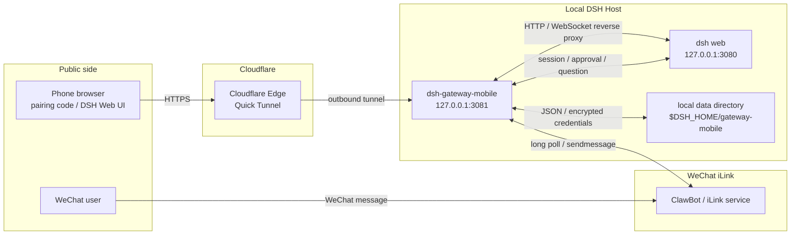
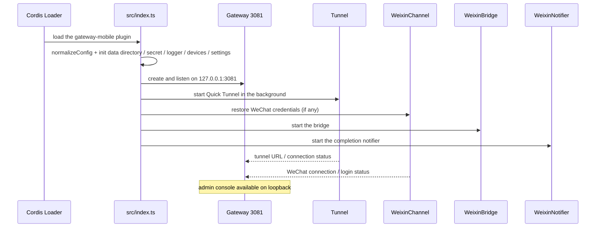
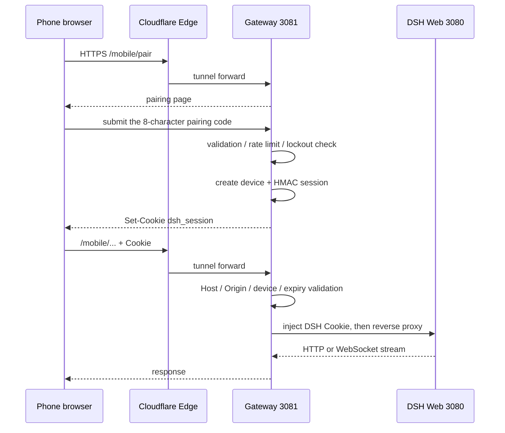
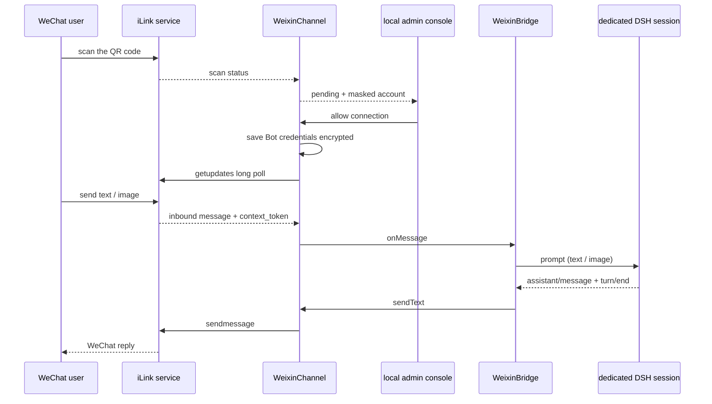
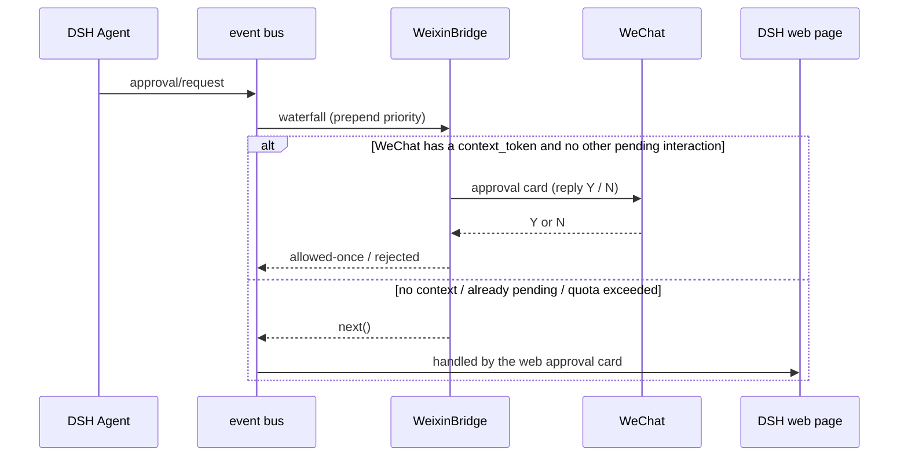
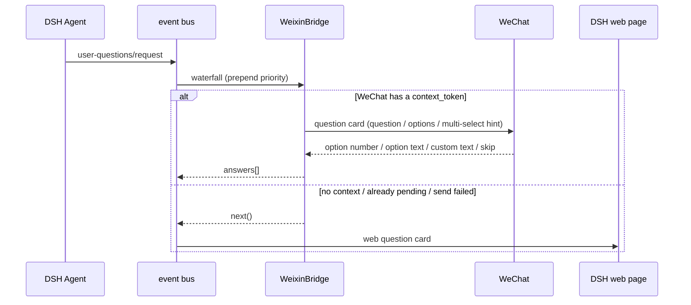
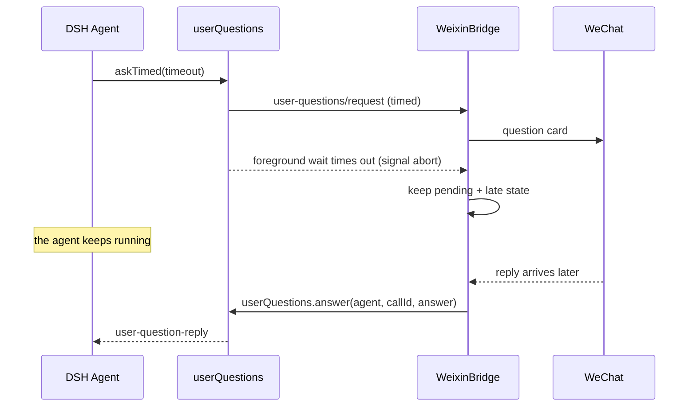
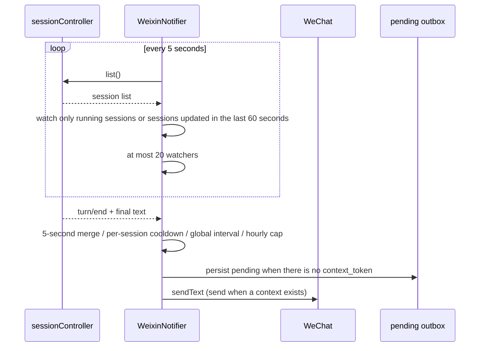
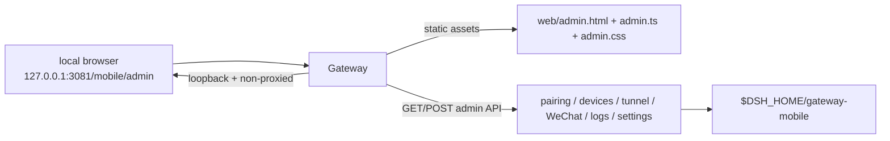

# dsh-gateway-mobile Architecture & Flow Diagrams

[English](./architecture-flow.md) | [中文](./architecture-flow.zh.md)

> Plugin version: `0.1.4`; verified against DSH `0.2.2-rc.1`.  
> This document describes the current implementation and does not include unimplemented plans.

## 1. System context

Plain-text topology:

```text
Phone browser --HTTPS--> Cloudflare Edge --outbound tunnel--> Gateway 127.0.0.1:3081
                                                                                      |
WeChat user --> WeChat iLink <--long poll / sendmessage-------------------------------+
                                                                                      | HTTP / WebSocket reverse proxy
                                                                                      v
                                                                           DSH Web 127.0.0.1:3080
                                                                                      |
                                                                                      v
                                                              local DSH session / tools / approvals / questions
```



Key boundaries:

- DSH listens only on the loopback address and is never exposed to the public internet directly.
- The only public entry point is the Cloudflare Quick Tunnel, terminating at the plugin's `127.0.0.1:3081`.
- WeChat does not go through Cloudflare; the plugin actively long-polls and sends messages through iLink.
- The admin console is reachable only from the local machine's loopback interface.

## 2. Components and modules

```mermaid
flowchart TB
  subgraph Entry["Cordis entry"]
    Index["src/index.ts<br/>inject DSH services / wiring"]
    Config["src/config.ts<br/>defaults / validation"]
  end

  subgraph Gateway["Gateway"]
    GatewaySvc["src/gateway.ts<br/>HTTP routes / admin API / reverse proxy"]
    Tunnel["src/tunnel.ts<br/>cloudflared lifecycle"]
    Cloudflared["src/cloudflared.ts<br/>binary resolution / download"]
    Proxy["src/proxy.ts<br/>DSH Cookie / HTTP+WS forwarding"]
    WS["src/ws.ts<br/>/mobile/ws control channel"]
    OAuth["src/oauth.ts<br/>GitHub / Gitee"]
    Pairing["src/pairing.ts<br/>one-time pairing codes"]
    Sessions["src/sessions.ts<br/>HMAC device sessions"]
    Devices["src/devices.ts<br/>device registration / revoke / expiry"]
    Settings["src/settings.ts<br/>admin settings persistence"]
    Stats["src/stats.ts<br/>request statistics"]
  end

  subgraph Weixin["WeChat"]
    Channel["src/weixin.ts<br/>iLink protocol / login / long poll"]
    Bridge["src/weixin-bridge.ts<br/>dedicated DSH session / approvals / questions"]
    Notifier["src/weixin-notifier.ts<br/>cross-session completion notices"]
  end

  subgraph Admin["Admin console"]
    AdminHTML["web/admin.html"]
    AdminTS["web/src/admin.ts"]
    AdminCSS["web/assets/admin.css"]
  end

  subgraph Shared["Shared infrastructure"]
    Store["src/store.ts<br/>atomic JSON / AES-GCM"]
    Logger["src/logger.ts<br/>logs / audit"]
    Errors["src/errors.ts"]
    Util["src/util.ts"]
    RateLimit["src/ratelimit.ts"]
  end

  Index --> Config
  Index --> GatewaySvc
  Index --> Channel
  Index --> Bridge
  Index --> Notifier
  GatewaySvc --> Tunnel
  Tunnel --> Cloudflared
  GatewaySvc --> Proxy
  GatewaySvc --> WS
  GatewaySvc --> OAuth
  GatewaySvc --> Pairing
  GatewaySvc --> Sessions
  GatewaySvc --> Devices
  GatewaySvc --> Settings
  GatewaySvc --> Stats
  GatewaySvc --> AdminHTML
  AdminHTML --> AdminTS
  AdminTS --> AdminCSS
  Bridge --> Channel
  Bridge --> Store
  Notifier --> Channel
  GatewaySvc --> Store
  GatewaySvc --> Logger
  GatewaySvc --> RateLimit
  GatewaySvc --> Errors
  GatewaySvc --> Util
```



### Module responsibilities

| Module | Responsibility |
|---|---|
| `src/index.ts` | Reads config, injects `webServer` / `connection` / `sessionController` / `workspaceRegistry` / `userQuestions`, and starts the gateway, tunnel, WeChat channel, bridge and notifier |
| `src/gateway.ts` | Loopback HTTP server, mobile pages, pairing/device/admin APIs, reverse proxy and admin-console static assets |
| `src/tunnel.ts` | Quick Tunnel startup, URL parsing, reconnect backoff and status reporting |
| `src/cloudflared.ts` | cloudflared path resolution, caching and auto-download |
| `src/proxy.ts` | Obtains and caches the DSH Cookie, HTTP/WS reverse proxy, header rewriting |
| `src/pairing.ts` | One-time 8-character pairing codes, TTL and failure lockout |
| `src/sessions.ts` | HMAC device Cookie, expiry and renewal |
| `src/devices.ts` | Device registration, revoke, cleanup and online WebSocket tracking |
| `src/weixin.ts` | QR login, encrypted credential storage, `getupdates` long polling, text/image download and `sendmessage` |
| `src/weixin-bridge.ts` | Dedicated WeChat DSH session, text/image questions, approvals and user Q&A, workspace binding and late answers |
| `src/weixin-notifier.ts` | Watches top-level session completion, 5-second merge, cooldown, hourly cap and pending outbox |
| `web/admin.*` | Local admin console: overview, pairing, WeChat, devices, logs and settings |

## 3. Startup flow



Processing order:

1. Cordis loads the plugin, validates config and initializes persistence.
2. Create the loopback gateway and start listening.
3. Start the Cloudflare Quick Tunnel in the background.
4. If `weixin-bot.json` exists, restore the WeChat connection and begin long polling.
5. Start `WeixinBridge` and `WeixinNotifier`.
6. On plugin dispose, close the gateway, tunnel, polling, bridge and notifier in order, and clear timers.

## 4. Phone pairing and access flow



Key points:

- The gateway issues its own device sessions; the phone never receives DSH's Cookie.
- The DSH Cookie is obtained via `ctx.connection.authenticatedUrl()` and kept only in plugin memory.
- Every request validates Host/Origin to cope with tunnel hostname changes and cross-site requests.
- The admin console is additionally restricted to "loopback and not via the tunnel proxy".

## 5. WeChat login and conversation flow



Key points:

- After scanning, the local admin console on the computer must confirm; credentials are not saved without confirmation.
- The full WeChat user ID is never persisted and never written to logs; it is used only in memory and masked when displayed.
- The dedicated DSH session prefers the current workspace; if there is none, it binds to the most recently updated workspace.
- Inbound WeChat messages provide a `context_token`, which is the prerequisite for later approvals, questions and notifications to be sent back to WeChat.

## 6. Approval flow

Approval event: `approval/request`.



Behavior:

- The WeChat approval prompt does not require typing a random ID; an approval ID is still generated internally for audit and history.
- Replies support `Y` / `N`, `允许` / `拒绝`, and `yes` / `no`.
- WeChat and the web page take over through a single channel: when WeChat has a context, WeChat handles it and the web page does not show a duplicate prompt; without a context, it falls back to the web page.
- Approval history records the session, tool, reason and status, but not the WeChat user ID.
- A 120-second timeout automatically rejects.

## 7. User question flow

Question event: `user-questions/request`.



Supported forms:

- single question, multi-question batches;
- single-select, multi-select;
- option numbers, option text, custom text;
- `跳过` (skip);
- `plan-review` forwarded as a user question with options.

Multi-question batches ask one question at a time, then merge the answers into a complete `answers` array and send it back.

### Late answers for timed questions



Limitations:

- only works for a root agent that is still alive;
- cannot be answered after the session closes or DSH restarts;
- the late-answer window is kept for 30 minutes;
- the default `legacy` question mode is unaffected.

## 8. Cross-session completion notification flow



Default policy:

```text
Merge window: 5 seconds
Per-session cooldown: 60 seconds
Global interval: 15 seconds
Hourly cap: 30 messages
```

Characteristics:

- watches top-level DSH sessions across all workspaces;
- skips child sessions, subagents and the dedicated WeChat session;
- does not watch every historical cold session, avoiding memory growth;
- the push pacing can be tuned in the admin console and takes effect immediately after saving;
- completion notices and approval notices use independent quotas and do not consume each other's.

## 9. Admin console flow



Page sections:

- Overview: device, request, tunnel and WeChat status;
- Pairing: pairing code, QR code and validity;
- WeChat: QR scan, connection status, rebind/disconnect, recent pushes and approval history;
- Devices: rename, revoke, cleanup;
- Logs: runtime logs and audit;
- Settings: pairing/session lifetimes, WeChat connection and push pacing.

## 10. Data and state files

```text
$DSH_HOME/gateway-mobile/
├── secret.key                     # HMAC / AES key
├── devices.json                   # device registry
├── admin-settings.json            # admin console settings
├── stats.json                     # request statistics
├── gateway.log                    # structured logs / audit JSONL
├── weixin-bot.json                # encrypted WeChat Bot credentials
├── weixin-session.json            # dedicated WeChat DSH session id
├── weixin-notify-state.json       # notification toggle / pacing / history
├── weixin-notify-pending.json     # pending outbox when there is no context
├── weixin-approval-history.json   # recent approval records
└── cloudflared/                   # auto-downloaded cloudflared
```

Notes:

- The full WeChat user ID is not written to any of the files above;
- The Bot token is stored encrypted with AES-GCM;
- Both the outbox and the history are bounded to avoid unbounded growth in long-running use.

## 11. Security and failure boundaries

| Boundary / failure | Behavior |
|---|---|
| Phone request Host is not the current tunnel domain | 403 |
| Origin does not match Host | Rejected |
| Not paired / session expired / device revoked | Rejected; re-pairing required |
| Admin API request comes from the tunnel | Rejected; only local loopback allowed |
| Tunnel disconnected | The gateway keeps running locally; the tunnel enters reconnecting/error state |
| DSH temporarily unavailable | The proxy returns 5xx; pairing and device sessions are unaffected |
| DSH Cookie invalid | Re-exchange and retry once on the first GET/HEAD 401 |
| WeChat has no context_token | Approvals/questions fall back to the web page; completion notices go to the outbox |
| WeChat approval/question already pending | New interactions fall back to the web page to avoid concurrency confusion |
| timed question timeout | Keep the late-answer window, then answer via `userQuestions.answer` |
| WeChat credentials invalid | Stop polling; re-scan the QR code and confirm locally |

## 12. Key design trade-offs

1. **DSH is not exposed publicly**: the public internet reaches only the gateway; DSH always stays on loopback.
2. **The phone does not hold the DSH Cookie**: the gateway holds and injects it, and devices use independent HMAC sessions.
3. **WeChat and the web page take over through a single channel**: when a WeChat context exists, WeChat handles approvals/questions, avoiding a lingering "waiting for approval" prompt on the web page.
4. **WeChat is not a second DSH**: a WeChat session is still an ordinary DSH Session, visible on desktop in the corresponding workspace.
5. **Notifications are not approvals**: completion notices, approvals and questions are three independent paths with separate rate limits and records.
6. **Fall back to the web page by default**: without a WeChat context, for complex interactions, when timed handling fails, or when sending fails, DSH is never blocked.
