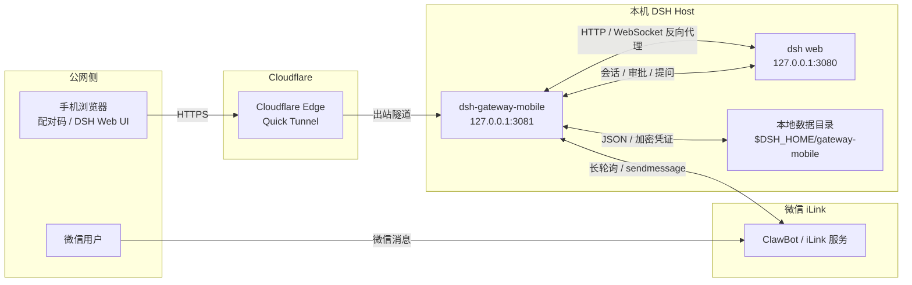
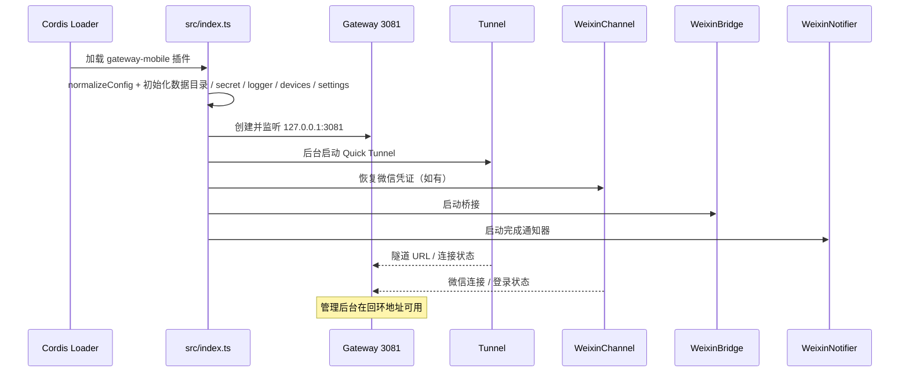
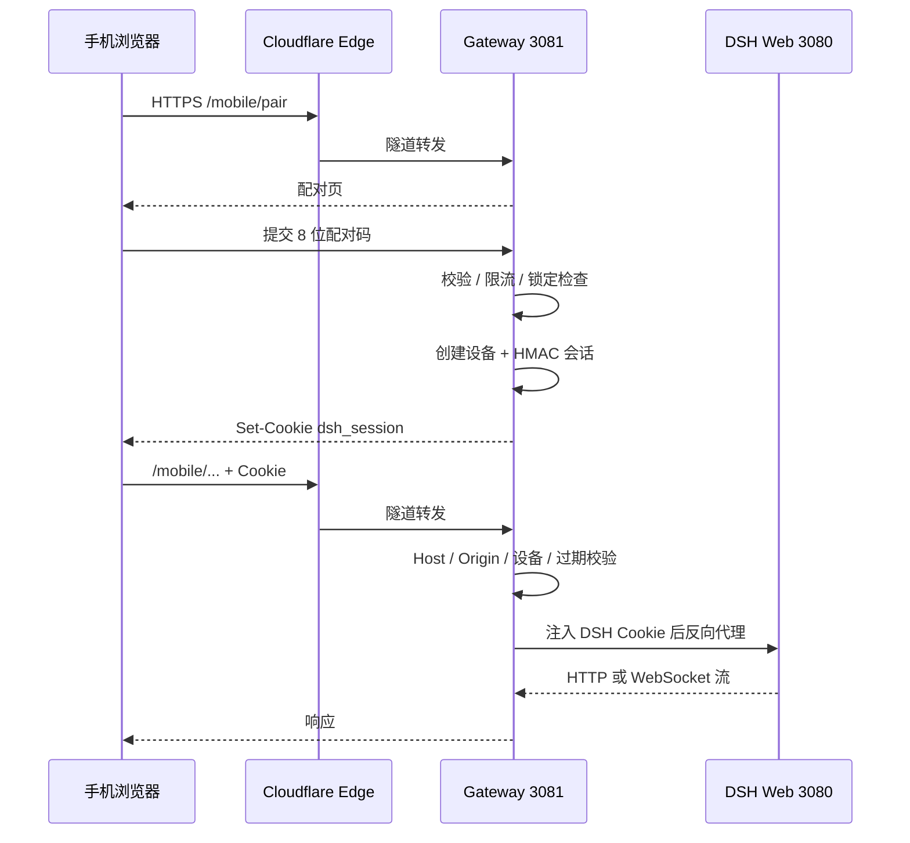
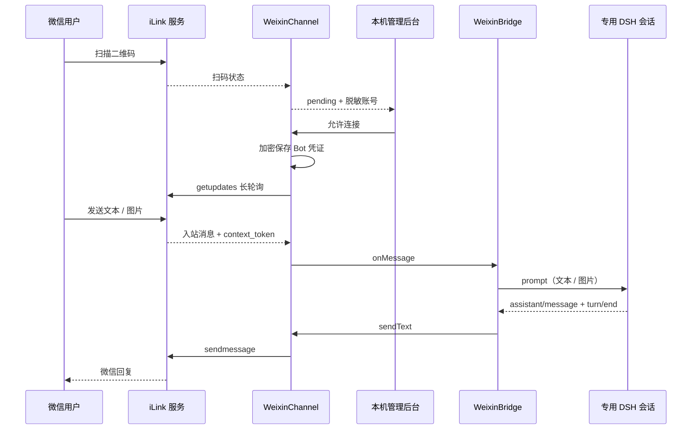
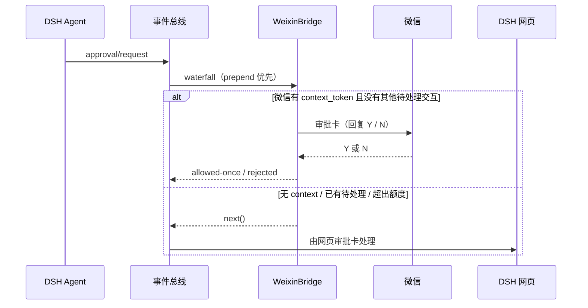
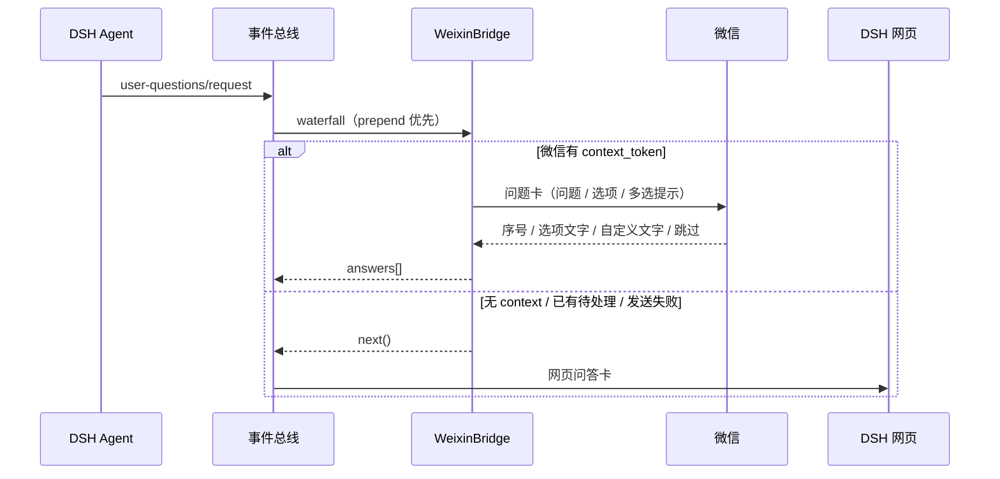
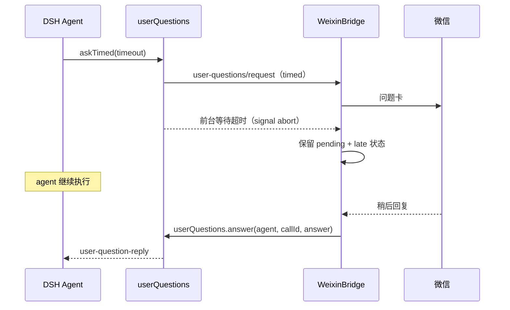
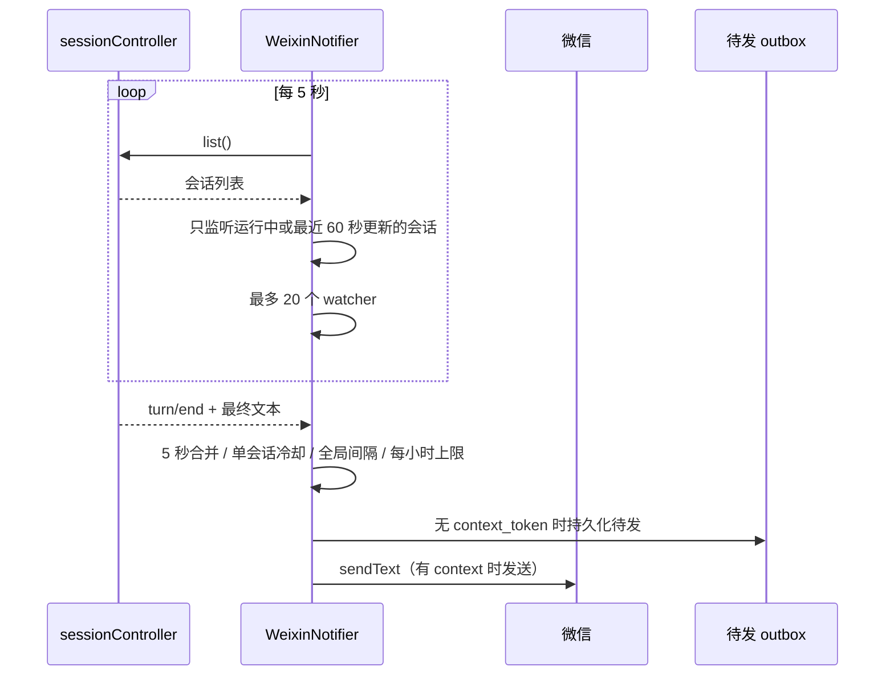
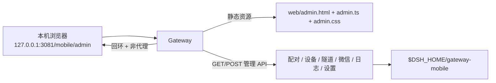

# dsh-gateway-mobile 架构与流程图

> 对应版本：插件 `0.1.1`，验证环境 DSH `0.2.1-rc.4`。  
> 本文描述当前实现，不包含未实现的计划项。

## 1. 系统上下文

纯文本拓扑：

```text
手机浏览器 ──HTTPS──► Cloudflare Edge ──出站隧道──► Gateway 127.0.0.1:3081
                                                        │
微信用户 ──► 微信 iLink ◄──长轮询 / sendmessage──────────┤
                                                        │ HTTP / WebSocket 反向代理
                                                        ▼
                                                  DSH Web 127.0.0.1:3080
                                                        │
                                                        ▼
                                              本地 DSH 会话 / 工具 / 审批 / 提问
```



关键边界：

- DSH 只监听回环地址，不直接暴露公网。
- 公网入口只有 Cloudflare Quick Tunnel，终止在插件的 `127.0.0.1:3081`。
- 微信不经过 Cloudflare；插件通过 iLink 主动长轮询和发送消息。
- 管理后台只在电脑本机回环可访问。

## 2. 组件与模块

```mermaid
flowchart TB
  subgraph Entry["Cordis 入口"]
    Index["src/index.ts<br/>注入 DSH 服务 / 组装"]
    Config["src/config.ts<br/>默认值 / 校验"]
  end

  subgraph Gateway["网关"]
    GatewaySvc["src/gateway.ts<br/>HTTP 路由 / 管理 API / 反向代理"]
    Tunnel["src/tunnel.ts<br/>cloudflared 生命周期"]
    Cloudflared["src/cloudflared.ts<br/>二进制解析 / 下载"]
    Proxy["src/proxy.ts<br/>DSH Cookie / HTTP+WS 转发"]
    WS["src/ws.ts<br/>/mobile/ws 控制通道"]
    OAuth["src/oauth.ts<br/>GitHub / Gitee"]
    Pairing["src/pairing.ts<br/>一次性配对码"]
    Sessions["src/sessions.ts<br/>HMAC 设备会话"]
    Devices["src/devices.ts<br/>设备注册 / 撤销 / 过期"]
    Settings["src/settings.ts<br/>管理端设置持久化"]
    Stats["src/stats.ts<br/>请求统计"]
  end

  subgraph Weixin["微信"]
    Channel["src/weixin.ts<br/>iLink 协议 / 登录 / 长轮询"]
    Bridge["src/weixin-bridge.ts<br/>专用 DSH 会话 / 审批 / 提问"]
    Notifier["src/weixin-notifier.ts<br/>跨会话完成通知"]
  end

  subgraph Admin["管理后台"]
    AdminHTML["web/admin.html"]
    AdminTS["web/src/admin.ts"]
    AdminCSS["web/assets/admin.css"]
  end

  subgraph Shared["共享基础设施"]
    Store["src/store.ts<br/>原子 JSON / AES-GCM"]
    Logger["src/logger.ts<br/>日志 / 审计"]
    Errors["src/errors.ts"]
    Util["src/util.ts"]
    RateLimit["src/ratelimit.ts"]
  end

  Index --> Config
  Index --> GatewaySvc
  Index --> Channel
  Index --> Bridge
  Index --> Notifier
  GatewaySvc --> Tunnel
  Tunnel --> Cloudflared
  GatewaySvc --> Proxy
  GatewaySvc --> WS
  GatewaySvc --> OAuth
  GatewaySvc --> Pairing
  GatewaySvc --> Sessions
  GatewaySvc --> Devices
  GatewaySvc --> Settings
  GatewaySvc --> Stats
  GatewaySvc --> AdminHTML
  AdminHTML --> AdminTS
  AdminTS --> AdminCSS
  Bridge --> Channel
  Bridge --> Store
  Notifier --> Channel
  GatewaySvc --> Store
  GatewaySvc --> Logger
  GatewaySvc --> RateLimit
  GatewaySvc --> Errors
  GatewaySvc --> Util
```



### 模块职责

| 模块 | 职责 |
|---|---|
| `src/index.ts` | 读取配置、注入 `webServer` / `connection` / `sessionController` / `workspaceRegistry` / `userQuestions`，启动网关、隧道、微信通道、桥接和通知器 |
| `src/gateway.ts` | 回环 HTTP 服务、移动端页面、配对/设备/管理 API、反向代理、管理后台静态资源 |
| `src/tunnel.ts` | Quick Tunnel 启动、URL 解析、重连退避、状态上报 |
| `src/cloudflared.ts` | cloudflared 路径解析、缓存与自动下载 |
| `src/proxy.ts` | 获取并缓存 DSH Cookie、HTTP/WS 反向代理、头部重写 |
| `src/pairing.ts` | 一次性 8 位配对码、有效期、失败锁定 |
| `src/sessions.ts` | HMAC 设备 Cookie、过期与续期 |
| `src/devices.ts` | 设备注册、撤销、清理、在线 WebSocket 跟踪 |
| `src/weixin.ts` | 扫码登录、凭证加密保存、`getupdates` 长轮询、文本/图片下载、`sendmessage` |
| `src/weixin-bridge.ts` | 微信专用 DSH 会话、文本/图片提问、审批与用户问答、workspace 绑定、迟到回答 |
| `src/weixin-notifier.ts` | 监听顶层会话完成、5 秒合并、冷却、每小时限额、待发 outbox |
| `web/admin.*` | 本机管理后台：概览、配对、微信、设备、日志、设置 |

## 3. 启动流程



处理顺序：

1. Cordis 加载插件，校验配置并初始化持久化。
2. 创建回环网关并开始监听。
3. 后台启动 Cloudflare Quick Tunnel。
4. 若存在 `weixin-bot.json`，恢复微信连接并开始长轮询。
5. 启动 `WeixinBridge` 和 `WeixinNotifier`。
6. 插件 dispose 时依次关闭网关、隧道、轮询、桥接、通知器并清理定时器。

## 4. 手机配对与访问流程



要点：

- 网关自己签发设备会话，手机永远拿不到 DSH 的 Cookie。
- DSH Cookie 由 `ctx.connection.authenticatedUrl()` 换取，只保存在插件内存。
- 每次请求校验 Host/Origin，避免隧道域名变化或跨站请求。
- 管理后台额外限制为“回环且非隧道代理”。

## 5. 微信登录与对话流程



要点：

- 扫码后必须由电脑本机管理后台确认，未确认不会保存凭证。
- 完整微信用户 ID 不持久化、不写日志；仅内存中使用，必要时脱敏显示。
- 专用 DSH 会话优先取当前 workspace；没有则按最近更新的 workspace 绑定。
- 微信入站消息提供 `context_token`，这是后续审批/提问/通知能发回微信的前提。

## 6. 审批流程

审批事件：`approval/request`。



行为：

- 微信审批提示不要求输入随机编号；内部仍生成审批 ID，用于审计和历史。
- 回复支持 `Y` / `N`、`允许` / `拒绝`、`yes` / `no`。
- 微信和网页是单通道接管：微信有上下文时由微信处理，网页不重复弹窗；没有上下文时回退网页。
- 审批历史记录会话、工具、原因、状态，不记录微信用户 ID。
- 超时 120 秒自动拒绝。

## 7. 用户问答流程

问答事件：`user-questions/request`。



支持形态：

- 单问题、多问题批次；
- 单选、多选；
- 选项序号、选项文字、自定义文字；
- `跳过`；
- `plan-review` 作为带选项的用户问题转发。

多问题按顺序逐个提问，回答完成后合并为完整 `answers` 再回传。

### timed 提问的迟到回答



限制：

- 只对仍存活的 root agent 有效；
- 会话关闭或 DSH 重启后不能补答；
- 迟到回答窗口保留 30 分钟；
- 默认 `legacy` 问答模式不受影响。

## 8. 跨会话完成通知流程



默认策略：

```text
合并窗口：5 秒
单会话冷却：60 秒
全局间隔：15 秒
每小时上限：30 条
```

特点：

- 监听所有 workspace 的顶层 DSH 会话；
- 跳过子会话、subagent、微信专用会话；
- 不监听所有历史冷会话，避免内存增长；
- 推送节奏可在管理后台调整，保存后立即生效；
- 完成通知和审批通知使用独立额度，互不占用。

## 9. 管理后台流程



页面分区：

- 概览：设备、请求、隧道、微信状态；
- 配对：配对码、二维码、有效期；
- 微信：扫码、连接状态、换绑/断开、最近推送、审批记录；
- 设备：重命名、撤销、清理；
- 日志：运行日志与审计；
- 设置：配对/会话时长、微信连接与推送节奏。

## 10. 数据与状态文件

```text
$DSH_HOME/gateway-mobile/
├── secret.key                     # HMAC / AES 密钥
├── devices.json                   # 设备注册表
├── admin-settings.json            # 管理后台设置
├── stats.json                     # 请求统计
├── gateway.log                    # 结构化日志 / 审计 JSONL
├── weixin-bot.json                # 加密微信 Bot 凭证
├── weixin-session.json            # 微信专用 DSH 会话 ID
├── weixin-notify-state.json       # 推送开关 / 节奏 / 历史
├── weixin-notify-pending.json     # 无 context 时的待发队列
├── weixin-approval-history.json   # 最近审批记录
└── cloudflared/                   # 自动下载的 cloudflared
```

注意：

- 完整微信用户 ID 不写入上述文件；
- Bot token 使用 AES-GCM 加密保存；
- 待发队列和历史都有上限，避免长期运行无限增长。

## 11. 安全与失败边界

| 边界 / 失败 | 行为 |
|---|---|
| 手机请求 Host 不是当前隧道域名 | 403 |
| Origin 与 Host 不一致 | 拒绝 |
| 未配对 / 会话过期 / 设备撤销 | 拒绝，要求重新配对 |
| 管理接口来自隧道 | 拒绝，只允许本机回环 |
| 隧道断开 | 网关继续在本机运行；隧道进入重连/错误状态 |
| DSH 暂不可用 | 代理返回 5xx；配对和设备会话不受影响 |
| DSH Cookie 失效 | 首次 GET/HEAD 401 时重新换取并重试一次 |
| 微信没有 context_token | 审批/提问回退网页；完成通知写入待发队列 |
| 微信审批/提问已有 pending | 新交互回退网页，避免并发混乱 |
| timed 提问超时 | 保留迟到回答窗口，之后通过 `userQuestions.answer` 补答 |
| 微信凭证失效 | 停止轮询；需要重新扫码并由本机确认 |

## 12. 关键设计取舍

1. **DSH 不暴露公网**：公网只到网关，DSH 始终在回环。
2. **手机不持有 DSH Cookie**：网关持有并注入，设备使用独立 HMAC 会话。
3. **微信与网页单通道接管**：有微信上下文时微信处理审批/提问，避免网页残留“等待审批”弹窗。
4. **微信不是第二套 DSH**：微信会话仍是一个普通 DSH Session，桌面端可在对应 workspace 看到。
5. **通知不是审批**：完成通知、审批、提问是三条独立链路，分别限流和记录。
6. **默认回退网页**：没有微信上下文、复杂交互、timed 失效或发送失败时，不阻塞 DSH。
